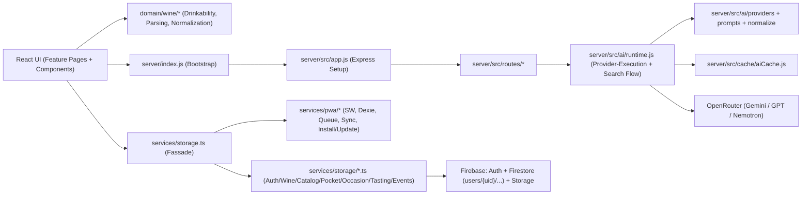

# Architektur IST (Stand 2026-11-24)

## Systemübersicht

## Firebase (seit 2026-11)

Supabase wurde vollständig durch Firebase ersetzt (Region `us-central1`, Blaze-Tarif mit Freikontingent):

| Vorher (Supabase) | Jetzt (Firebase) |
|---|---|
| Supabase Auth (E-Mail + anonym) | Firebase Authentication (E-Mail + anonym) |
| Postgres-Tabellen + RLS | Firestore `users/{uid}/<tabelle>/{id}` + `firestore.rules` |
| FK-Cascades, `updated_at`-Trigger | Firestore-Batches in `services/storage.legacy.ts` |
| `wine_catalog` (global) + pg_trgm-Suche | `users/{uid}/wine_catalog` + `domain/wine/catalogSearch.ts` (gleiche Trigramm-Formel) |
| Storage-Bucket `wine-images` (signierte URLs) | Cloud Storage `users/{uid}/wine-images/...` (Download-URLs ohne Ablauf) + `storage.rules` |
| Express-Server (lokal, auf Vercel nicht deployt) | Cloud Function `api` (`server/functions.js`), Hosting-Rewrite `/api/**` |
| Vercel Hosting | Firebase Hosting (`firebase.json`) |

Wichtige Entscheidungen:

- **Zeitstempel bleiben ISO-Strings.** Die Delta-Sync-Cursor in `services/pwa/syncEngine.ts` vergleichen Strings; so blieb die Sync-Schicht unverändert.
- **Lesen nur vom Server** (`getDocsFromServer`): `getDocs()` liefert offline still einen leeren Cache, was die Hard-Delete-Reconciliation den lokalen Dexie-Cache löschen ließe.
- **Keine Composite-Indizes:** Filter auf zweite Felder (z. B. `type == 'consume'` beim Delta-Pull) passieren clientseitig.
- **Weinkatalog pro Nutzer** statt global: bei einer Ein-Personen-App gleichwertig und datenschutzfreundlicher.

## Umgesetzte Refactor-Bausteine

1. Toolchain/Gates
- Lokales Tailwind (`tailwind.config.cjs`, `postcss.config.cjs`, `index.css`)
- ESLint + Prettier + Vitest konfiguriert
- Einheitliches Gate: `npm run ci:check`

2. Frontend-Struktur
- Feature-Einstiegspunkte sind auf Ordnerstruktur umgestellt:
  - `features/inventory/InventoryPage.tsx`
  - `features/wine-detail/WineDetailPage.tsx`
  - `features/enjoyment-plan/EnjoymentPlanPage.tsx`
- Legacy-Dateien bleiben als kompatible Thin-Wrapper (`features/Inventory.tsx`, `features/WineDetail.tsx`, `features/EnjoymentPlan.tsx`).

3. Domain-Extraktion
- Drinkability nach `domain/wine/drinkability.ts`
- JSON-Parser nach `domain/wine/jsonParsers.ts`
- Import/Normalisierung nach `domain/wine/normalization.ts`
- `utils.ts` bietet Backward-Compat Re-Exports.

4. Storage-Aufteilung
- Fachliche Repositories unter `services/storage/*.ts`
- Kompatible Fassade bleibt unverändert über `services/storage.ts`

5. Backend-Modularisierung
- `server/index.js` nur noch Bootstrap
- `server/src/app.js` enthält nur Setup/Middleware/Route-Wiring
- AI-Ausführung (Provider-Fallbacks, Prompt-Reparatur, Cache, JSON-Normalisierung) in `server/src/ai/runtime.js`
- AI-Hilfsmodule in:
  - `server/src/ai/providers/*`
  - `server/src/ai/prompts/*`
  - `server/src/ai/normalize/normalizeWineJson.js`
  - `server/src/cache/aiCache.js`

6. PWA/Offline-Layer
- Vite PWA via `vite-plugin-pwa` (`injectManifest`) in `vite.config.ts`.
- Service Worker: `services/pwa/sw.ts` (Precache + Runtime-Caching + Offline-Fallback).
- Lokaler Persistenzlayer via Dexie:
  - `services/pwa/offlineDb.ts`
  - Queue-/Sync-Typen: `services/pwa/types.ts`
- Offline-first Storage-Adapter:
  - `services/pwa/storageOfflineAdapter.ts`
  - Delegation in `services/storage/index.ts`
- Sync-/Queue-Engine:
  - `services/pwa/syncEngine.ts`
  - `services/pwa/conflictResolver.ts`
  - `services/pwa/aiQueue.ts`
  - `services/pwa/aiQueueProcessor.ts`
- Install-/Update-UX:
  - `services/pwa/installPrompt.ts`
  - `services/pwa/swRegistration.ts`
  - Integration in `index.tsx` und `features/Settings.tsx`.

## Qualitätsstatus

1. `npm run ci:check` ist grün.
2. Build ohne `>500kB` Warnung (Lazy Routes + `manualChunks`).
3. Unit-Tests decken Drinkability, JSON-Parser, Normalisierung und API-Grundpfade ab.
4. Zusätzliche PWA-Unit-Tests decken Dexie, Queue, Konfliktauflösung und Install-Prompt ab.
5. PWA-Smokes vorhanden in:
  - `tests/pwa.offline.spec.ts`
  - `tests/pwa.sync.spec.ts`

## Bekannte Restarbeit

1. Die drei großen Frontend-Feature-Pages sind zwar in Feature-Ordnern, intern aber noch weiter aufteilbar (Ziel: kleinere Komponenten/Hooks/Mappers).
2. `server/src/ai/runtime.js` kann als nächster Schritt weiter in kleinere Services zerlegt werden (Search/Assignment/Vision getrennt).
3. Sync-Konfliktauflösung ist als `Last Write Wins` implementiert; optionaler manueller Konfliktdialog ist noch nicht vorhanden.
